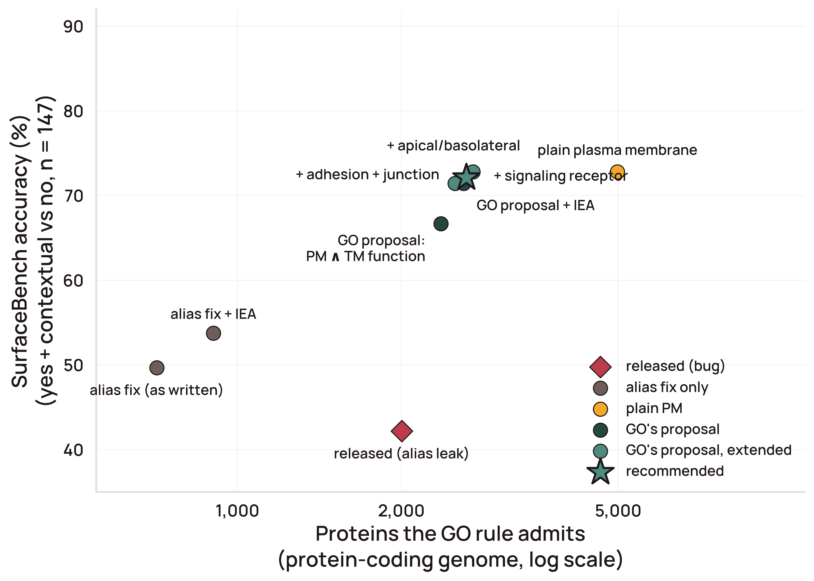

# GO surface-rule variants: inclusion cost vs SurfaceBench accuracy

*2026-10-21. Prompted by the Gene Ontology team's re-analysis of the GO
baseline in the accessible-surfaceome preprint
([artifact](https://claude.ai/artifact/WCjRqayPU7HqmNMi6YwR78)). Numbers
below are computed from the GO artifacts pinned in this repo
(`go-basic.obo` release 2026-03-25, `goa_human.gaf` generated 2026-03-28)
by [`scripts/audit/audit_go_surface_rule_tradeoff.py`](../../scripts/audit/audit_go_surface_rule_tradeoff.py).*



## What the published GO column actually computed

The Methods describe the GO rule as "any non-IEA annotation to cell surface
(GO:0009986), external side of plasma membrane (GO:0009897) or integral
component of plasma membrane (GO:0005887), with descendants; plain plasma
membrane excluded as too broad". That is not what ran.

`GO:0005887` was merged into `GO:0005886` (plasma membrane) and survives only
as an `alt_id`. goatools resolves alt_ids silently, so
`src/accessible_surfaceome/sources/go.py` received the *plasma membrane* term
for its third root and expanded all 416 of its `is_a` + `part_of`
descendants. Because the visited set was seeded with the alias string rather
than the real ID, plain plasma membrane itself was never included. The
released column is therefore:

> non-IEA annotation to cell surface, external side of PM, **or any
> sub-compartment of the plasma membrane** (apical, basolateral, caveola,
> postsynaptic membrane, lamellipodium membrane, *cytoplasmic side of PM*, …)
> **but not plain plasma membrane**.

That is why KRAS, LYN, JAK1-3, RHOA and TYK2 (annotated to cytoplasmic side of
PM) score as GO-surface while GCGR, SSTR2 and FLT3 (plain PM only) do not.
Our own `go_term_metadata.json` recorded the substitution (root name "plasma
membrane", 416 descendants). The April 2026 liveness check against the GO
term endpoint passed because that endpoint also resolves the alias.

On SurfaceBench (n = 147) this leaked rule gives the published 42.2 %. The
rule as written gives 49.7 % on our GAF (52.4 % on GO's May 2026 GAF).

In the candidate universe, 1,252 of the 2,022 GO-flagged rows have only
PM-subtree roots; 465 of those have GO as their sole database vote. The
benchmark itself was selected on database disagreement using the leaked
column, so GO can be re-scored on it but the benchmark cannot be re-derived.

## Rule variants scored

All with `is_a` + `part_of` descendants; `NOT`-qualified rows excluded; non-IEA
evidence unless marked.

| Variant | Definition |
|---|---|
| Released column (alias leak) | outward ∨ (PM subtree − PM itself) |
| Alias fix, as written | outward = cell surface ∨ external side of PM |
| Alias fix + IEA | same, all evidence codes |
| Plain plasma membrane | PM subtree incl. GO:0005886 |
| **GO's proposal** | outward ∨ (PM ∧ TM function), TM function = transmembrane signaling receptor activity (GO:0004888) ∨ transmembrane transporter activity (GO:0022857) ∨ channel activity (GO:0015267) |
| GO's proposal + IEA | same, all evidence codes |
| + adhesion + junction | GO's proposal ∨ (PM ∧ cell adhesion mediator activity GO:0098631) ∨ desmosome / tight junction / gap junction |
| **+ apical/basolateral (recommended)** | previous ∨ apical PM (GO:0016324) ∨ basolateral PM (GO:0016323) |
| + signaling receptor | previous ∨ (PM ∧ signaling receptor activity GO:0038023) |

## Results

Cost = proteins admitted across the 19,464-gene protein-coding cohort.
"New" = admitted proteins not already in the 5,680-row candidate universe.
Accuracy = binary (yes + contextual vs no, n = 147), the paper's metric.
Yes-vs-no drops the 31 contextual proteins (n = 116).

| Variant | Admitted | New to universe | Accuracy | Yes vs no | Recall (yes+ctx) | Specificity (no) |
|---|---|---|---|---|---|---|
| Released column (alias leak) | 2,003 | 0 | 42.2 % | 44.8 % | 0.38 | 0.50 |
| Alias fix, as written | 711 | 0 | 49.7 % | 56.9 % | 0.28 | 0.94 |
| Alias fix + IEA | 903 | 40 | 53.7 % | 58.6 % | 0.34 | 0.94 |
| Plain plasma membrane | 4,984 | 924 | 72.8 % | 69.8 % | 0.92 | 0.33 |
| GO's proposal | 2,363 | 82 | 66.7 % | 75.9 % | 0.56 | 0.90 |
| GO's proposal + IEA | 2,602 | 130 | 71.4 % | 78.4 % | 0.63 | 0.90 |
| + adhesion + junction | 2,507 | 109 | 71.4 % | 81.0 % | 0.63 | 0.90 |
| **+ apical/basolateral (recommended)** | 2,631 | 109 | 72.1 % | 81.9 % | 0.64 | 0.90 |
| + signaling receptor | 2,705 | 123 | 72.8 % | 82.8 % | 0.65 | 0.90 |

GO's "all evidence" row reproduces the artifact's 48/68, 14/31, 5/48 exactly;
the non-IEA rows differ from the artifact by a few genes because of GAF
vintage (March vs May 2026).

## Recommendation

Adopt **GO's proposal + adhesion + junction + apical/basolateral**, non-IEA:

```
surface ⇐ cell surface ∨ external side of plasma membrane
        ∨ apical plasma membrane ∨ basolateral plasma membrane
        ∨ desmosome ∨ tight junction ∨ gap junction
        ∨ ( plasma membrane ∧ ( transmembrane signaling receptor activity
                              ∨ transmembrane transporter activity
                              ∨ channel activity
                              ∨ cell adhesion mediator activity ) )
```

- Same cost as today's GO vote (2,631 vs 2,003 proteins; 109 new to the
  universe), so Figure 1 and the 5-DB vote barely move.
- Specificity 0.90, on par with UniProt (0.94), up from 0.50.
- Every added term is a location GO already treats as outward-facing or
  junctional, and the rule keeps the paper's non-IEA evidence policy.
- The signaling-receptor extension buys one benchmark gene for 74 proteins
  and re-introduces GO:0038023, which we dropped in April because it admits
  endosomal pattern-recognition receptors; not worth it.
- Plain plasma membrane looks competitive on the binary metric only because
  the benchmark is contextual-heavy; it calls 32 of 48 "no" proteins surface.

## Where GO's ceiling is, and why

Every extended variant clusters at ~72 % binary / ~82 % yes-vs-no. The same
five false positives survive all of them (F2, TF, VEGFA bound to cell
surface; ITPR1, ITPR3 ER channels with a PM annotation), and the same misses
recur: GPI-anchored proteins (LYPD1, LYPD3, PSCA, DPEP1), ectoenzymes (CA9,
STEAP1, STEAP2, GUCY2C) and orphans (GPNMB, SEZ6, DLK1, GYPA, TM4SF1). These
have no outward-facing GO term at all because "anchored component of
membrane" was obsoleted without re-annotation. New curation, not a better
rule, is what moves GO past this point; that list is the concrete ask for
the GO collaboration.

## Follow-ups (not in this change)

1. Guard `sources/go.py` so a configured root must resolve to its own ID
   (reject alt_id substitution) and adopt the recommended rule.
2. Re-pull, rebuild the candidate universe and the figure TSVs, and
   re-draw the GO panel of Supplementary Figure 1 (its current "baseline"
   diamond is the leaked rule).
3. Correct the Methods: report 42.2 % as the leaked rule, the rule as
   written, and the corrected GO baseline side by side.
